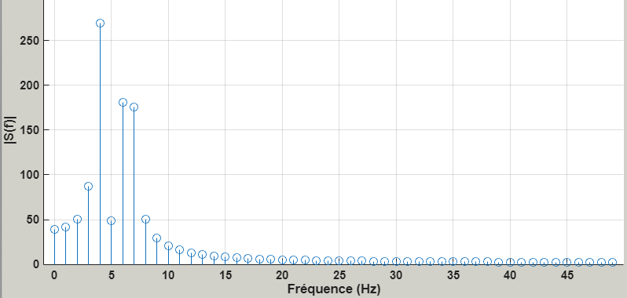
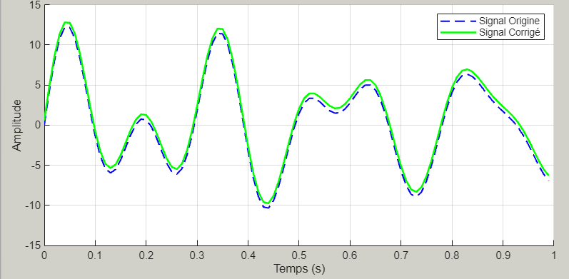
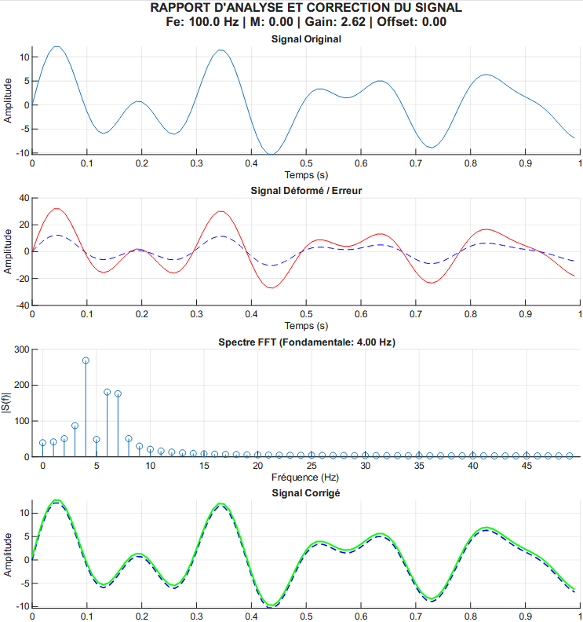

# signal-fft-matlab

*[English version below](#english)*

## Français

### Objectif

Simuler une **chaîne de mesure** sous MATLAB : un capteur fournit un signal, et la chaîne lui fait subir une **déformation** (offset, gain, non-linéarité). On cherche à **estimer** les paramètres de cette déformation, notamment par analyse **FFT**, puis à **corriger** le signal pour retrouver le signal d'origine.

Le signal de référence dure 1 s. Il est composé d'une valeur moyenne et d'une somme d'harmoniques :

s(t) = M + Σ Ai · sin(2π · Fi · t)

### Déformations modélisées

| Choix | Déformation | Modèle (`deform_signal`) |
|---|---|---|
| 1 | Offset | `sd = s + P0` |
| 2 | Gain | `sd = P1 · s` |
| 3 | Gain puis offset | `sd = P1 · s + P0` |
| 4 | Offset puis gain | `sd = P1 · (s + P0)` |
| 5 | Exponentielle | `sd = P0 · exp(P1 · s)` |
| 6 | Logarithme | `sd = P0 + P1 · sign(s) · log(1 + \|s\|)` |

### Méthode

- **Offset** : on part du signal centré, dont la raie à 0 Hz est nulle. Après déformation, la partie réelle de la raie à 0 Hz (c'est-à-dire la moyenne) donne directement P0, avec son signe.
- **Gain** : on ajoute +1 au signal centré pour disposer d'une composante continue connue. Le rapport des raies à 0 Hz (déformé / base) donne P1 : son module donne |P1| et sa phase (0 ou π) donne le signe.
- **Gain + offset, offset + gain** : le gain est mesuré sur le pic alternatif dominant (f > 0 Hz), où l'offset n'agit pas, avec la même règle module/phase. L'offset est ensuite déduit de la composante continue.
- **Exponentielle** : on linéarise avec ln|sd| = ln|P0| + P1 · s.
  - Comme la référence est centrée, la moyenne donne ln|P0|.
  - La valeur efficace et la phase sur l'harmonique dominante, comparées à celles connues de la référence (Ai, Fi), donnent P1.
- **Logarithme** : la partie logarithmique est impaire et la référence est antisymétrique sur une seconde, donc la moyenne du signal déformé donne P0.
  - Le signe de P1 se lit sur la phase de l'harmonique dominante.
  - Le module |P1| est l'unique valeur pour laquelle le signal reconstruit retrouve la valeur efficace de la référence. Il est obtenu avec `fzero`.
- **Correction** : on applique la transformation inverse avec les paramètres estimés.

Les estimations n'utilisent jamais les vrais paramètres. Pour l'exponentielle et le logarithme, elles n'utilisent pas non plus le signal de base, seulement ses caractéristiques connues (Ai, Fi). Ces estimations supposent :
- des fréquences Fi entières et distinctes ;
- des fréquences strictement comprises entre 0 et fe/2 ;
- une durée de 1 s.

### Utilisation

Il faut MATLAB **R2016b ou plus récent**. **Aucune toolbox** n'est nécessaire.

```matlab
demo
```

`demo.m` génère le signal et applique chacune des 6 déformations, d'abord avec des paramètres positifs, puis avec des paramètres négatifs. Pour chaque cas, il estime les paramètres, corrige le signal et ouvre une figure en trois parties :
- le signal de base et le signal déformé ;
- les spectres ;
- la correction.

Un tableau récapitulatif des paramètres vrais et estimés, avec l'erreur de reconstruction, s'affiche dans la console.

Chaque correcteur peut aussi être appelé seul :

```matlab
[s_base, s_deforme, s_corrige, gain, offset] = correcteGAIN_OFFSET(2, [5 3 2], [4 6 7], 100, -4, -1.5);
```

| Fichier | Rôle |
|---|---|
| `gene_signal.m` | Génération du signal de référence |
| `deform_signal.m` | Les 6 déformations |
| `correcteOFFSET.m`, `correcteGAIN.m`, `correcteGAIN_OFFSET.m`, `correcteOFFSET_GAIN.m` | Estimation et correction des déformations linéaires |
| `correcteExponentielle.m`, `correcteLogarithmique.m` | Estimation et correction des déformations non linéaires |
| `echelle_reference.m` | Facteur d'échelle signé par rapport à la référence (valeur efficace et phase) |
| `trace_resultats.m` | Tracés communs : spectres et correction |
| `demo.m` | Démonstration complète sans interface |
| `ihm_code.m` | Interface App Designer (code extrait) |

### Images

Ces captures proviennent de l'interface d'origine, avant les corrections listées plus bas.

**Spectre FFT du signal** (raie dominante à 4 Hz)



**Correction d'un gain** : signal d'origine (bleu pointillé) et signal corrigé (vert)



**Rapport d'analyse exporté** : signal original, signal déformé, spectre et signal corrigé



### Interface App Designer

`ihm_code.m` contient le code extrait de l'application App Designer, alignée sur les fonctions corrigées. Il se lance avec `ihm_code` (MATLAB R2019b ou plus récent pour `tiledlayout` et `exportgraphics`, utilisés par l'export PDF). Les éléments décoratifs (images, son) ont été retirés : il ne reste que les graphiques, les curseurs, les boutons et les champs.

Le fichier .mlapp n'est pas publié car il intègre des visuels sous droits ; une version nettoyée sera ajoutée.

L'interface comporte 7 onglets :

| Onglet | Contenu |
|---|---|
| **Accueil** | Titre du projet et résumé des onglets |
| **Signal** | Curseurs M, A1–A3, f1–f3 et fe ; tracé du signal de référence |
| **Erreur** | Choix de la déformation, linéaire (OFFSET, Gain, Gain + OFFSET, OFFSET + Gain) ou non linéaire (exponentielle, logarithmique), réglage de P0/P1, tracé du signal d'origine et du signal déformé |
| **FFT** | Spectre du signal et fréquence fondamentale (raie dominante hors 0 Hz) |
| **Estimation** | Choix du correcteur, spectres du signal de base et du signal déformé, valeurs estimées de P0 et P1 |
| **Correction** | Signal d'origine et signal corrigé |
| **Option** | Mode debug (figures supplémentaires : signal généré, signal déformé, composantes f1, f2, f3), export CSV (temps et signal déformé) et export PDF (rapport A4 avec les quatre graphiques) |

**Écarts entre l'IHM d'origine et les fonctions corrigées**, repris dans `ihm_code.m` :

1. **Ordre des paramètres non linéaires** : l'onglet Estimation appelait `correcteExponentielle(..., lambda, mu, ...)` et `correcteLogarithmique(..., lambda, mu, ...)`, alors que l'onglet Erreur passait `deform_signal(s, choix, mu, lambda)`. Les deux onglets utilisent maintenant `(P0, P1)` dans l'ordre de `deform_signal`. Les curseurs μ et λ sont renommés P0 et P1.
2. **Sorties des correcteurs non linéaires** : ils renvoient `[P0_estime, P1_estime]` et non plus `[lambda, mu]`. Les champs « OFFSET estimer » et « GAIN estimer » deviennent « P0 estimé » et « P1 estimé » (pour les déformations linéaires, P0 est l'offset et P1 le gain). Le contournement `double(real(lambda_m(1)))`, qui masquait les valeurs complexes de l'ancien logarithme, est supprimé.
3. **Fonction `spectre` absente du dépôt** : l'onglet FFT appelait `spectre(ax, s, fe)`. Le calcul est intégré à `ihm_code.m`, avec un spectre normalisé par N comme dans `trace_resultats.m`.
4. **Erreurs explicites** : les correcteurs signalent maintenant un gain nul, un P0 nul (exponentielle) ou l'absence d'harmonique. L'IHM les intercepte et les affiche dans une boîte de dialogue.
5. **Hypothèses des estimateurs** : les fréquences Fi sont arrondies à l'entier (curseurs de 1 à 10 Hz) ; fe est arrondie et limitée à 25–200 Hz au lieu de 0–100 Hz (fe = 0 était remplacée par 1). Les valeurs par défaut sont celles de `demo.m` (M = 2, Ai = [5 3 2], Fi = [4 6 7], fe = 100) au lieu de zéro.
6. **Libellés** : « OSSFET » devient « OFFSET » (boutons, curseur et tests du `switch`), et « Exporter un .cvs » devient « Exporter un .csv ».
7. **Divers** : la FFT était recalculée deux fois à chaque changement de curseur ; les callbacks vides sont supprimés ; la classe est renommée `ihm_code` pour correspondre au nom du fichier.

### Contexte

Ce projet a été réalisé en équipe de trois dans le cadre de l'ECUE 325 à l'EPISEN.

### Bugs corrigés après le rendu

1. **Composante continue sans signe** : `abs(fft(...))` perdait le signe de la raie à 0 Hz. Un offset de −2 était ainsi mesuré à +2, et un gain de −3 à +3. La composante continue est désormais lue avec `real(fft(...))`, c'est-à-dire la moyenne.
2. **Signe du gain** : il est maintenant déterminé par la phase du rapport des raies (0 ou π).
3. **Exponentielle** :
   - le correcteur supposait `exp(λ·s) + μ` alors que `deform_signal` appliquait `P0·exp(P1·s)` ;
   - l'estimation utilisait la vraie valeur de λ.

   Les deux utilisent désormais le même modèle, linéarisé par ln|sd|.
4. **Logarithme** :
   - `log(s)` d'un signal centré produisait des valeurs complexes ;
   - le correcteur supposait un autre modèle ;
   - la correction utilisait `sign(s_base)`, c'est-à-dire le signal d'origine.

   Le modèle est remplacé par un logarithme symétrique inversible, commun aux deux fonctions, et l'estimation se fait sans le signal de base.
5. **Tracé « Origine »** : il affichait le signal non centré, de moyenne M, et non le signal de base réellement déformé puis corrigé. Les courbes paraissaient donc décalées même quand la correction était parfaite.
6. **Tracés dupliqués** : le code de tracé, répété dans les six correcteurs, est factorisé dans `trace_resultats.m`.
7. **Robustesse** :
   - un gain nul ou l'absence d'harmonique provoque désormais un message d'erreur explicite au lieu d'un `NaN` ;
   - les paramètres des déformations non linéaires s'appellent P0/P1, comme dans `deform_signal`.

---

<a id="english"></a>

## English

### Goal

Simulate a **measurement chain** in MATLAB: a sensor produces a signal, and the chain applies a **distortion** to it (offset, gain, non-linearity). The goal is to **estimate** the distortion parameters, mainly through **FFT** analysis, then **correct** the signal to recover the original.

The reference signal lasts 1 s. It is made of a mean value plus a sum of harmonics:

s(t) = M + Σ Ai · sin(2π · Fi · t)

### Modelled distortions

| Choice | Distortion | Model (`deform_signal`) |
|---|---|---|
| 1 | Offset | `sd = s + P0` |
| 2 | Gain | `sd = P1 · s` |
| 3 | Gain then offset | `sd = P1 · s + P0` |
| 4 | Offset then gain | `sd = P1 · (s + P0)` |
| 5 | Exponential | `sd = P0 · exp(P1 · s)` |
| 6 | Logarithm | `sd = P0 + P1 · sign(s) · log(1 + \|s\|)` |

### Method

- **Offset**: the base signal is centred, so its 0 Hz bin is zero. After distortion, the real part of the 0 Hz bin (that is, the mean) gives P0 directly, sign included.
- **Gain**: +1 is added to the centred signal so that its DC component is known. The ratio of the 0 Hz bins (distorted / base) gives P1: its magnitude gives |P1| and its phase (0 or π) gives the sign.
- **Gain + offset, offset + gain**: the gain is measured on the dominant AC peak (f > 0 Hz), where the offset has no effect, using the same magnitude/phase rule. The offset is then derived from the DC component.
- **Exponential**: linearised with ln|sd| = ln|P0| + P1 · s.
  - Since the reference is centred, the mean gives ln|P0|.
  - The RMS value and the phase on the dominant harmonic, compared with the known reference (Ai, Fi), give P1.
- **Logarithm**: the logarithmic part is odd and the reference is antisymmetric over one second, so the mean of the distorted signal gives P0.
  - The sign of P1 is read from the phase of the dominant harmonic.
  - |P1| is the unique value for which the reconstructed signal matches the reference RMS. It is found with `fzero`.
- **Correction**: the inverse transform is applied with the estimated parameters.

The estimators never use the true parameters. For the exponential and logarithm cases, they do not use the base signal either, only its known characteristics (Ai, Fi). The estimators assume:
- integer, distinct frequencies Fi;
- frequencies strictly between 0 and fe/2;
- a duration of 1 s.

### Usage

Requires MATLAB **R2016b or later**. **No toolbox** is needed.

```matlab
demo
```

`demo.m` generates the signal and applies each of the 6 distortions, first with positive parameters, then with negative ones. For each case it estimates the parameters, corrects the signal and opens a three-part figure:
- base and distorted signals;
- spectra;
- correction.

A summary table of true and estimated parameters, with the reconstruction error, is printed in the console.

Each corrector can also be called on its own:

```matlab
[s_base, s_deforme, s_corrige, gain, offset] = correcteGAIN_OFFSET(2, [5 3 2], [4 6 7], 100, -4, -1.5);
```

| File | Role |
|---|---|
| `gene_signal.m` | Reference signal generation |
| `deform_signal.m` | The 6 distortions |
| `correcteOFFSET.m`, `correcteGAIN.m`, `correcteGAIN_OFFSET.m`, `correcteOFFSET_GAIN.m` | Estimation and correction of linear distortions |
| `correcteExponentielle.m`, `correcteLogarithmique.m` | Estimation and correction of non-linear distortions |
| `echelle_reference.m` | Signed scale factor relative to the reference (RMS and phase) |
| `trace_resultats.m` | Shared plots: spectra and correction |
| `demo.m` | Full demonstration without a GUI |
| `ihm_code.m` | App Designer interface (extracted code) |

### Images

These screenshots come from the original interface, before the fixes listed below.

- `images/spectre-fft.png`: FFT spectrum of the signal (dominant line at 4 Hz)
- `images/correction-gain.png`: gain correction, original signal (dashed blue) vs corrected signal (green)
- `images/rapport-analyse.png`: exported analysis report (original, distorted, spectrum, corrected)

### App Designer interface

`ihm_code.m` contains the code extracted from the App Designer application, aligned with the fixed functions. Run it with `ihm_code` (MATLAB R2019b or later for `tiledlayout` and `exportgraphics`, used by the PDF export). Decorative elements (images, sound) have been removed: only the plots, sliders, buttons and fields remain.

The .mlapp file is not published because it embeds copyrighted visuals; a cleaned-up version will be added.

The interface has 7 tabs:

| Tab | Content |
|---|---|
| **Accueil** (Home) | Project title and summary of the tabs |
| **Signal** | M, A1–A3, f1–f3 and fe sliders; plot of the reference signal |
| **Erreur** (Error) | Choice of distortion, linear (OFFSET, Gain, Gain + OFFSET, OFFSET + Gain) or non-linear (exponential, logarithmic), P0/P1 settings, plot of the original and distorted signals |
| **FFT** | Signal spectrum and fundamental frequency (dominant line above 0 Hz) |
| **Estimation** | Choice of corrector, spectra of the base and distorted signals, estimated P0 and P1 |
| **Correction** | Original and corrected signals |
| **Option** | Debug mode (extra figures: generated signal, distorted signal, f1, f2, f3 components), CSV export (time and distorted signal) and PDF export (A4 report with the four plots) |

**Differences between the original GUI and the fixed functions**, applied in `ihm_code.m`:

1. **Order of the non-linear parameters**: the Estimation tab called `correcteExponentielle(..., lambda, mu, ...)` and `correcteLogarithmique(..., lambda, mu, ...)`, while the Error tab passed `deform_signal(s, choix, mu, lambda)`. Both tabs now use `(P0, P1)` in the `deform_signal` order. The μ and λ sliders are renamed P0 and P1.
2. **Outputs of the non-linear correctors**: they return `[P0_estime, P1_estime]` instead of `[lambda, mu]`. The "OFFSET estimer" and "GAIN estimer" fields become "P0 estimé" and "P1 estimé" (for linear distortions, P0 is the offset and P1 the gain). The `double(real(lambda_m(1)))` workaround, which hid the complex values of the old logarithm, is removed.
3. **`spectre` function missing from the repository**: the FFT tab called `spectre(ax, s, fe)`. The computation is now built into `ihm_code.m`, with the spectrum normalised by N as in `trace_resultats.m`.
4. **Explicit errors**: the correctors now report a zero gain, a zero P0 (exponential) or a missing harmonic. The GUI catches these errors and shows them in a dialog box.
5. **Estimator assumptions**: the Fi frequencies are rounded to integers (sliders from 1 to 10 Hz); fe is rounded and limited to 25–200 Hz instead of 0–100 Hz (fe = 0 used to be replaced by 1). The default values are those of `demo.m` (M = 2, Ai = [5 3 2], Fi = [4 6 7], fe = 100) instead of zero.
6. **Labels**: "OSSFET" becomes "OFFSET" (buttons, slider and `switch` cases), and "Exporter un .cvs" becomes "Exporter un .csv".
7. **Miscellaneous**: the FFT was computed twice on every slider change; empty callbacks are removed; the class is renamed `ihm_code` to match the file name.

### Context

This project was carried out by a team of three as part of course unit ECUE 325 at EPISEN.

### Bugs fixed after submission

1. **Unsigned DC component**: `abs(fft(...))` lost the sign of the 0 Hz bin. An offset of −2 was measured as +2, and a gain of −3 as +3. The DC component is now read with `real(fft(...))`, that is, the mean.
2. **Gain sign**: now given by the phase of the bin ratio (0 or π).
3. **Exponential**:
   - the corrector assumed `exp(λ·s) + μ` while `deform_signal` applied `P0·exp(P1·s)`;
   - the estimation used the true value of λ.

   Both now share the same model, linearised through ln|sd|.
4. **Logarithm**:
   - `log(s)` of a centred signal produced complex values;
   - the corrector assumed a different model;
   - the correction used `sign(s_base)`, that is, the original signal.

   The model is replaced by an invertible symmetric logarithm shared by both functions, and the estimation no longer uses the base signal.
5. **"Original" plot**: it showed the uncentred signal, with mean M, instead of the base signal that was actually distorted and then corrected. The curves therefore looked offset even when the correction was perfect.
6. **Duplicated plotting code**: the plotting block, repeated in all six correctors, is now factored into `trace_resultats.m`.
7. **Robustness**:
   - a zero gain or a missing harmonic now raises an explicit error instead of producing `NaN`;
   - the non-linear distortion parameters are named P0/P1, as in `deform_signal`.
